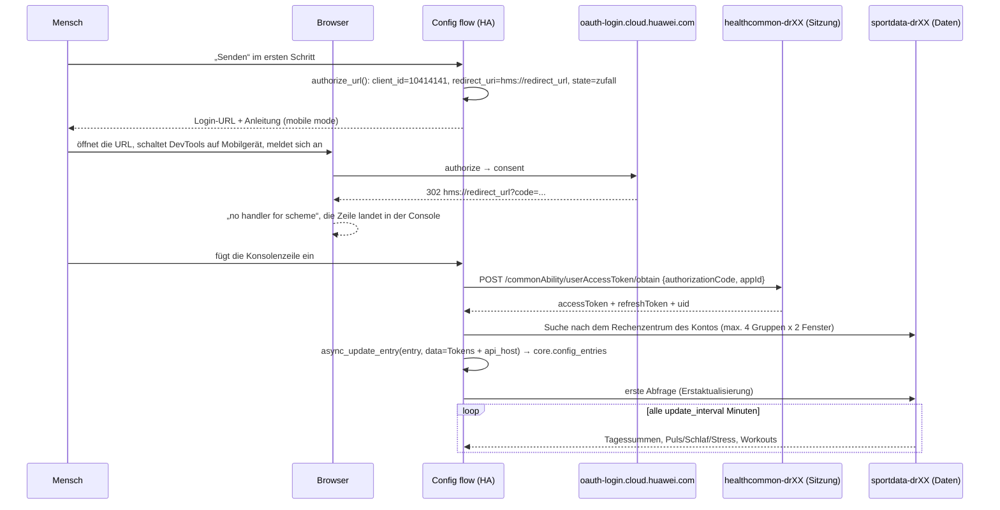

# Huawei Health für Home Assistant

Diese Integration liest aus **der eigenen Cloud der Huawei-Health-App**
(`com.huawei.health`) und erzeugt Sensoren für Schritte, Schlaf, Puls, Stress und
Workouts. Telefon, Uhr und die Health-App müssen dafür nicht laufen: nötig ist nur ein
Browser, in dem alle 180 Tage einmal ein HUAWEI-ID-Login durchgeführt wird.

Unterstützt werden **mehrere Konten gleichzeitig** — jedes als eigener
Integrationseintrag, mit eigenen Tokens, eigenem Abfrageintervall und eigenem
Sensorsatz.

> **English summary.** *(Dieses README ist auf Deutsch; die folgende Zusammenfassung ist
> englisch.)*
> This is a custom Home Assistant integration for the Huawei Health app's own
> cloud (`sportdata-drXX.things.dbankcloud.*`), **not** for the Health Kit API. It needs no
> phone, no watch and no Huawei emulator. Login is browser-assisted (Huawei's captcha is
> meant for a human), the token pair is then rotated by the integration itself for 180 days.
> Multiple accounts = multiple config entries. Install through HACS, then follow *Konto
> verbinden* below — the consent button only responds to touch, so the browser has to be
> switched to mobile device mode in DevTools. If every sensor reads `unknown` while the
> login sensor works, the wrong data centre is being queried: see
> *Which data centre holds this account's data*.

---

## Inhaltsverzeichnis

- [Warum eine weitere Integration](#warum-eine-weitere-integration)
- [Was die Sensoren liefern](#was-die-sensoren-liefern)
- [Voraussetzungen](#voraussetzungen)
- [Installation](#installation)
- [Konto verbinden](#konto-verbinden)
- [Wie die Integration arbeitet](#wie-die-integration-arbeitet)
- [Kontoeinstellungen](#kontoeinstellungen)
- [Mehrere Konten](#mehrere-konten)
- [Automatisierungsbeispiele](#automatisierungsbeispiele)
- [Fehlerbilder](#fehlerbilder)
- [Sicherheit und Grenzen](#sicherheit-und-grenzen)
- [Entwicklung und Releases](#entwicklung-und-releases)

---

## Warum eine weitere Integration

Der offizielle Weg („Health Kit / REST API for Partners“) verlangt eine registrierte App in
AppGallery Connect, eine Verifizierung durch Huawei und die Zustimmung des Nutzers für
einzelne Scopes; die Daten kommen in einem anderen Format und nicht für alle Typen.
Bestehende Integrationen (Aufzählungen in `custom_components`-Repositories) lesen
üblicherweise einen Export aus der App.

Diese Integration benutzt dieselbe Cloud, in die die App `com.huawei.health` ihre mit der
Uhr synchronisierten Daten hochlädt: die Controller-Routen unter `/dataQuery/*`. Das
Protokoll ist aus dem APK 16.1.6.320 rekonstruiert (dex-Code `defpackage/*`,
`HealthDataCloudFactory`, `ThirdPartyHttpUtils`) und mit Live-Requests geprüft. Die App hat
die Hostnamen nicht hartkodiert — sie holt sie von GRS (Global Route Service, der
Routing-Dienst von HMS Core, der je Länderkennung des Kontos die URLs der Rechenzentren
ausliefert). Für RU-Konten sind das `*.things.dbankcloud.ru`; die Hostliste liegt in
`assets/grs_app_global_route_config.json`. Welches Rechenzentrum die Zeilen eines Kontos
hält, ist die häufigste Fehlerquelle — dazu unten der Abschnitt
[Welches Rechenzentrum die Daten hält](#welches-rechenzentrum-die-daten-hält).

Die Sensoren zeigen **dieselben Zahlen wie die App**, bis hin zu den Tagesschritten: die
Integration verarbeitet genau die Antworten, die auch der Bildschirm „Aktivität“ zeichnet.

## Was die Sensoren liefern

Tageswerte beziehen sich auf „heute“ (beim Schlaf auf die gerade beendete Nacht — die Cloud
stempelt sie mit dem Tag des Aufwachens). Jeder Sensor trägt das Attribut `date` mit dem
Datum, für das der Wert gekommen ist.

| Sensor | Einheit | Woher |
| --- | --- | --- |
| Schritte heute | Schritte | `getSportsStat` → `sportBasicInfo.steps` |
| Distanz heute | km | `getSportsStat` → `distance` (im Antworten Meter, durch 1000) |
| Kalorien heute | kcal | `getSportsStat` → `calorie` (im Antworten Tausendstel kcal, durch 1000) |
| Aktivität heute | min | `getSportsStat` → `duration` |
| Gehen heute | min | `dimenDailyActivity.walkDurations` |
| Aktive Stunden heute | h | `activeHourBasic.countActiveHour` |
| Moderate bis intensive Minuten heute | min | `exerciseTimeBasic.totalMidHighIntensity` |
| Schrittziel | Schritte | `goalAchieveBasic.stepGoalValueStat` (standardmäßig deaktiviert) |
| Puls in Ruhe, Puls, Max, Min | bpm | `getHealthStat` Typ 7 → `heartRateBasic` |
| Herzfrequenz (Messpunkte) | bpm | `getHealthData` Typ 7 — **Messpunkte statt Tageswert**, standardmäßig deaktiviert (siehe [Granularität](#wie-fein-die-pulskurve-wirklich-ist)) |
| Schlaf, Tiefschlaf, REM, leichter Schlaf, wach | min | `getHealthStat` Typ 9 → `professionalSleep` |
| Schlafbewertung, Effizienz, HRV, SpO2 | Punkte / % / ms | ebenda: `sleepScore`, `sleepEfficiency`, `lastAvgHrv`, `lastAvgSpO2` |
| Stress, Stress (letzte Messung) | Punkte | `getHealthStat` Typ 11 → `stressBasic` |
| Letzte Aktivität | enum (running/cycling/…) | `getSportsDataByTime`, Segment zu Session zusammengesetzt |
| Dauer / Distanz / Kalorien der letzten Aktivität | min, km, kcal | ebenda |
| Workouts im Zeitraum | Anzahl | Anzahl Sessions im Fenster |
| Wiederanmeldung in Tagen | Tage | Restlaufzeit des refreshToken |

Typen mit Nullwert (`lastAvgSpO2 = -1`, `avgRestingHeartRate = 0` usf.) bedeuten: es gibt
keine Messung, nicht „Messung null“.

### Was übersetzt ist und was nicht

Die Texte des Login-Ablaufs und die Beschriftungen im Einstellungsdialog kommen aus
[`translations/de.json`](custom_components/huawei_health/translations/de.json) (daneben
`en.json` und `ru.json`, drei Dateien mit identischem Schlüsselbestand).

**Die Anzeigenamen der Sensoren nicht.** `entity.py` setzt
`_attr_has_entity_name = False`, damit Name und `entity_id` ohne Geräte- bzw. Area-Präfix
bleiben; Home Assistant fragt eine Übersetzung unter `entity.sensor.*.name` aber nur ab,
wenn genau dieses Flag `True` ist. Sichtbar bleibt deshalb das `name` aus `DESCRIPTIONS` in
`sensor.py` — englisch, und für `en.json`/`ru.json` gilt dasselbe. Die Sensor-Spalte der
Tabelle oben sagt, wofür ein Sensor steht; der Name in der Oberfläche ist englisch
(„Schritte heute“ ↔ `Steps today`). Das Flag auf `True` zu drehen würde die Übersetzung
aktivieren, stellte aber allen 29 Sensoren den Nicknamen der HUAWEI ID voran
(`andrey Schritte heute`) — bewusst nicht getan.

Wer die Integration in eine weitere Sprache übersetzt, hält alle drei Dateien parallel:
gleiche Schlüssel, gleiche Platzhalter (`{authorize_url}`, `{account}`, `{docs}` — Home
Assistant validiert das beim Laden).

## Voraussetzungen

- Home Assistant **2024.12** oder neuer.
- Ein HUAWEI-ID-Konto, in dem synchronisierte Daten liegen (die Health-App muss also
  mindestens einmal Daten in die Cloud hochgeladen haben).
- Ein Rechner mit Browser (Chrome/Chromium oder Firefox) für den Login.
- Die Integration installiert keine PyPI-Abhängigkeiten: nur Python-Standardbibliothek.

## Installation

### Über HACS

1. **HACS → ⋮ (drei Punkte) → Custom repositories** öffnen.
2. Type: `Integration`, Repository: `https://github.com/and7ey/huawei_health`, **Add**.
3. In der Liste nach **Huawei Health** suchen → blauer Knopf **Download**.
4. Home Assistant neu starten (**Einstellungen → System → Knopf „Herunterfahren“ →
   Home Assistant neu starten** — nicht „Konfiguration neu laden“, sondern ein
   Systemneustart).

### Manuell

`huawei_health.zip` aus dem [letzten Release](../../releases) herunterladen und so
entpacken, dass im Konfigurationsordner von Home Assistant der Pfad
`custom_components/huawei_health/manifest.json` entsteht, danach Home Assistant neu starten.

## Konto verbinden

Der Login ist die einzige Stelle, an der ein Mensch nötig ist: die
Zustimmungsseite sitzt hinter Huaweis Captcha. Alles andere (Tausch des Codes gegen Tokens,
Ablage, Rotation, Abfragen) läuft automatisch.

### Schritt 1. Den Integrationseintrag anlegen

**Einstellungen → Geräte und Dienste → Integrationen → Integration hinzufügen →
Huawei Health**.

Der erste Bildschirm zeigt die fertige Login-URL — sie wird pro Vorgang neu erzeugt (mit
eigenem `state` und eigenen `scope`), man muss sie also nicht aus diesem README
kopieren:

```text
https://oauth-login.cloud.huawei.com/oauth2/v3/authorize?client_id=10414141
  &response_type=code&access_type=offline&display=touch&scope=...
  &redirect_uri=hms%3A%2F%2Fredirect_url&state=<8 zufällige Zeichen>&lang=en&prompt=consent
```

**Senden** drücken — die Integration kommt auf den Bildschirm, auf dem der Code eingefügt
wird.

### Schritt 2. Die URL im Browser öffnen und den Mobilmodus einschalten

Das ist der entscheidende Punkt: **der Knopf „Allow“/„Zulassen“ auf der
Zustimmungsseite reagiert nur auf Touch.** Ein normaler Mausklick darauf funktioniert nicht —
die Seite lädt nicht neu, sie zeigt auch keinen Fehler an. Der Browser muss deshalb in den
Modus eines mobilen Geräts wechseln.

Ablauf in **Chrome** (gleich in Yandex Browser, Edge, Opera — alle auf Chromium):

1. Die Login-URL in einem neuen Tab öffnen und in der HUAWEI ID anmelden (Telefonnummer
   oder E-Mail plus Passwort). Fragt Huawei nach einer Bestätigung auf einem Gerät oder per
   Mail, bestätige sie.
2. **F12** drücken. Das DevTools-Fenster erscheint meist rechts oder unten. Gleichwertig:
   Menü **⋮ → Weitere Tools → Entwicklertools** oder **Strg+Shift+I** (macOS
   **Cmd+Option+I**).
3. In den DevTools **Strg+Shift+M** (macOS **Cmd+Shift+M**) drücken. Das ist
   **Toggle device toolbar**, das ganz linke Symbol in der oberen Leiste der DevTools, ein
   Rechteck mit Telefon. Danach erscheint über der Seite eine zusätzliche Leiste, und die
   Seite zeigt mit ihrem Rahmen, dass sie „in einem Gerät“ steckt.
4. In dieser Leiste oben links ist das Auswahlfeld **Dimensions: Not responsive**. Darin ein
   konkretes Gerät wählen, zum Beispiel **iPhone 12 Pro** oder **Pixel 7**
   (**Responsive** geht auch, mit einem echten Geräteprofil wird die Wahrscheinlichkeit
   einer Desktop-Ansicht aber kleiner).
5. **Reload** drücken — der Kreispfeil in derselben DevTools-Leiste (oder **F5**). Die
   Seite muss *nach* dem Umschalten neu geladen werden: erst dann liefert Huawei die
   Mobilversion, in der der Zustimmungs-Knopf ein Touch-Element ist. Hat die Seite ihr
   Aussehen geändert (schmal, der Knopf eine große Fläche) — richtig.
6. Bis zum Knopf **„Allow“ / „Zulassen“** scrollen und ihn drücken. Der Cursor ist im
   Mobilmodus ein Kreis und arbeitet wie ein Finger: ein Druck genügt.

In **Firefox** statt der DevTools-Leiste: **F12 → Telefon-/Tablett-Symbol
(Strg+Shift+M)** — danach genauso.

Passiert nach „Allow“ nichts, wurde der Mobilmodus auf die bereits geladene Seite nicht
angewendet: Punkt 5 (Reload) wiederholen und noch mal drücken.

### Schritt 3. Den Code aus der Browser-Konsole holen

Nach der Zulassung versucht der Browser, `hms://redirect_url?code=...` zu öffnen. Das ist
die Adresse der Health-App auf dem Telefon; auf dem Rechner ist für dieses Schema kein
Handler registriert, der Sprung bleibt aus und Chrome schreibt das in die Konsole. **Genau
diese Zeile wird gebraucht** — sie enthält den Code:

```text
Failed to launch 'hms://redirect_url?code=EQFEAQNaOARz0K1p%2BmR7sT4uVwXyZ0abcDEFghIJ%2FklMNopqrSTuvwXYZ0123456789%3D%3D&state=9f2c1ab7' because the scheme does not have a registered handler.
```

So finden und kopieren:

1. **F12 → Reiter Console**. Die Zeile steht normalerweise schon dort (gelb oder rot). Im
   Filter links kann `Failed to launch` eingegeben werden, um nicht suchen zu müssen.
2. Mit Rechtsklick auf die Zeile → **Copy text** (oder ganz markieren und **Strg+C**).
3. In **Firefox** statt der Konsole einfacher: **F12 → Reiter Network → der erste Request
   mit Status 302 → Antwortheader `Location`** — dort steht dieselbe
   `hms://redirect_url?code=...`-Adresse.
4. Den kopierten Text in das Feld der Integration einfügen und **Senden** drücken. Über-
   und Untertext (`Failed to launch '`, `because the scheme...`, Anführungszeichen) wirft
   die Integration selbst weg — der Code wird aus der Query-Zeile geschnitten und
   zwingend decodiert, weil er percent-encoded und rund 360 Zeichen lang ist (`%2B`, `%2F`,
   `%3D%3D` darin bleiben unverändert, von Hand ist nichts zu „reparieren“).

**Der Code ist einmalig und einige Minuten gültig.** Meldet die Integration, Huawei habe ihn
abgelehnt, ist er abgelaufen oder war schon benutzt: die Login-Seite über eine neue URL neu
öffnen (die Integration erzeugt sie auf dem Schritt „Erneut anmelden“ neu) und den Ablauf
wiederholen.

### Schritt 4. Das Ergebnis prüfen

Die Integration tauscht den Code gegen das Tokenpaar, erkennt das Konto an der `uid`, sucht
selbst das Rechenzentrum, in dem die Daten des Kontos liegen (darüber unten mehr), und
legt den Eintrag mit dem Nicknamen der HUAWEI ID als Namen an. Nach 10–30 Sekunden
erscheinen die Sensoren. Der Eintragsname (Nickname der HUAWEI ID) wird zum „Gerät“, die
`entity_id` enthält ihn aber **nicht**: `has_entity_name` ist `False`, und
`entity_platform.py` hängt den Gerätenamen nur dann an, wenn es `True` ist. Die IDs folgen
dem englischen Anzeigenamen, zum Beispiel:

```text
sensor.steps_today                    sensor.sleep_duration
sensor.distance_today                 sensor.last_activity
sensor.re_login_due_in_days           sensor.workouts_in_period
```

Bei mehreren Konten bekommt das zweite denselben Stamm mit Suffix:
`sensor.steps_today_2`, `sensor.sleep_duration_2` usf. — welches Konto welchen Stammt,
steht auf der Geräteseite (**Einstellungen → Integrationen → Huawei Health → Eintrag**).
Stabil ist die `unique_id` (`<entry_id>_<schlüssel>`, z. B. `0a1b…_relogin_in`): über sie
lassen sich die IDs im Entitäten-Register umbenennen, und Automatisierungen bleiben nach
einem Reload gültig.

Der Unterschied zwischen `unknown` und `unavailable` ist wichtig: **`unknown` bei lebendem
„Wiederanmeldung in Tagen“ (= `sensor.re_login_due_in_days`) = 180** heißt, die Cloud
antwortet erfolgreich, aber leer — die falsche GRS-Gruppe wird abgefragt oder das Konto hat
keine Daten. **`unavailable`** heißt, die Cloud antwortet mit einem Fehler, oder dieser
Datentyp ist in diesem Konto nicht gefüllt (zum Beispiel misst kein Gerät SpO2). Was genau
gefragt wurde und was zurückkam, steht in den Attributen von
`sensor.re_login_due_in_days`.

## Wie die Integration arbeitet

### Gesamtablauf



### Module

| Datei | Zuständigkeit |
| --- | --- |
| `const.py` | Adressen der Controller, Endpfade, IDs der Sport-/Metriktypen, Fehlercodes, Konstanten für HA |
| `client.py` | Protokoll: HTTP über `urllib` der Standardbibliothek, Header, Requestbody, Rotation, Antworten parsen, Regionssuche. Kein einziger Import von Home Assistant |
| `config_flow.py` | Login-URL, Annahme des eingefügten Codes, Tausch gegen Tokens, Regionsuche beim Anlegen, Eindeutigkeit des Kontos, erneute Anmeldung, Einstellungen |
| `coordinator.py` | `DataUpdateCoordinator`: die drei Datenfamilien im Worker-Thread abfragen, Teilergebnisse und Fehler, Snapshot für die Sensoren, Diagnosefelder |
| `__init__.py` | Client bauen, Region festhalten, rotierte Tokens zurückschreiben, Neuladen bei geänderten Einstellungen oder gewechselter Region |
| `entity.py` | gemeinsame Basisklasse: ein „Service-Gerät“ pro Konto |
| `sensor.py` | Sensorbeschreibungen und das Herausholen aus dem Snapshot |
| `tools/probe.py` | Diagnose eines Kontos vom Terminal aus, ohne Home Assistant |

### Authentifikation: wie die Requests genau laufen

Das Token ist in dieser Cloud **nicht nur ein Header**. Die App (`Suggestion_CloudFactory` /
`gkp.java`) legt es ins JSON-Body **und** in die Header, und die Cloud verlangt genau diese
Kombination:

```json
{
  "token": "<accessToken>", "tokenType": 2, "appId": "com.huawei.health",
  "ts": 1770000000000, "source": 1, "siteId": 0,
  "startTime": 20260929, "endTime": 20260929, "dataSource": 2
}
```

```http
Authorization: Bearer <accessToken>
x-token: <accessToken>
x-token-type: 2
x-huid: <uid>
x-version: and_health_16.1.6.320
Content-Type: application/json;charset=UTF-8
```

Das Tokenpaar lebt auf einem Controller (`healthcommon-drXX`), die Daten auf einem anderen
(`sportdata-drXX`); in der GRS-Tabelle sind das zwei verschiedene Routen —
`domainHealthCloudCommon` gegenüber `healthCloudUrl`.

### Lebensdauer der Tokens

- `authorizationCode` (aus dem Browser) → `POST /commonAbility/userAccessToken/obtain` →
  `accessToken` + `refreshToken` + `uid`. `siteId` kann in der Antwort fehlen — fürs Lesen
  ist das ohne Wirkung.
- `accessToken` lebt einige Dutzend Minuten. Vor jeder Abfrage vergleicht die Integration
  `expires_at` mit der jetzigen Zeit und rotiert, wenn weniger als 2 Minuten bleiben:
  `POST /commonAbility/userAccessToken/refresh` mit **zahlendem** `appId=10414141` (nicht
  dem Paketnamen).
- Die Rotation **tötet den vorherigen accessToken** und gibt denselben `refreshToken`
  zurück — der neue `accessToken` wird deshalb sofort in `entry.data` geschrieben
  (`hass.config_entries.async_update_entry`).
- `resultCode` 1002/1004 („Token nicht akzeptiert“) heißt, dass die Health-App auf dem
  Telefon die Paarrotation schon selbst gemacht hat: die Integration rotiert und wiederholt
  den Request genau einmal.
- `refreshToken` lebt 180 Tage (`REFRESH_TOKEN_INTERVAL = 15552000000` ms). Danach hilft nur
  der Browser-Login: die Integration fängt `20020003`, wirft `ConfigEntryAuthFailed`, und HA
  zeigt die Karte **Konfigurieren** — derselbe Login-Ablauf, ohne neuen Eintrag.
- Der Sensor „Wiederanmeldung in Tagen“ (`sensor.re_login_due_in_days`) zeigt die
  Restlaufzeit des refreshToken, das Nahterücken lässt sich automatisieren. Er bleibt auch
  dann lesbar, wenn alle anderen Sensoren leer sind: sein Wert kommt aus dem Tokenpaar
  (`data_dependent=False`), und dort stehen die Diagnoseattribute.

### Was bei einer Abfrage gelesen wird

| Schritt | Endpunkt | Zeitformat |
| --- | --- | --- |
| Tagessummen | `/dataQuery/sport/v2/getSportsStat` | `startTime`/`endTime` als Zahlen `YYYYMMDD` |
| Puls, Schlaf, Stress, Intensität | `/dataQuery/health/getHealthStat` (`types: [7,9,11,12]`) | `YYYYMMDD` |
| Workouts | `/dataQuery/sport/getSportsDataByTime` (`queryType: 1`, `dataType: 2`) | `YYYYMMDD`, Fenster **höchstens 10 Tage** |
| Puls-Messpunkte (Granularität) | `/dataQuery/health/getHealthData` (`types: [7]`) | Millisekunden (`queryType: 2`), Fenster **höchstens 10 Tage**; die Tagesform `YYYYMMDD` dient als Fallback |

Berücksichtigt:

1. `*ByTime` antwortet mit `1001` auf ein Fenster über 10 Kalendertage — 30 Tage werden
   deshalb von `day_windows()` zerlegt, und die Sätze aus den Fenstern werden über `dataId`
   dedupliziert.
2. Sekundentimecodes akzeptiert die Cloud nirgends (nur `YYYYMMDD` für `queryType: 1` und
   Millisekunden für `queryType: 2`).
3. `calorie` kommt in Tausendstel kcal, `distance` in Metern, `duration` in Minuten;
   `recordDay` ist `YYYYMMDD`.

### Wie Workouts entstehen

`getSportsDataByTime` liefert **keine Workouts, sondern Minuten-Segmente**, und jedes
Gerät, das eine Minute gesehen hat, schickt ihr Exemplar davon (Uhr und Telefon — zwei
Sätze derselben Fahrt). Deshalb (`client.sport_sessions`):

1. Segmente nach `sportType` gruppieren;
2. pro Typ und Minute den Satz mit der größten Leistung behalten
   (Distanz, Schritte, Kalorien);
3. benachbarte Minuten zu einer Session verbinden, wenn der Abstand höchstens 15 Minuten
   beträgt;
4. die Session liefert Dauer, Distanz, Kalorien, Segmentanzahl und `deviceCode`.

Darum stimmt „Letzte Aktivität“ (`sensor.last_activity`) mit der App überein, die Summe der
Rohsegmente nicht.

### Wie fein die Pulskurve wirklich ist

`getHealthStat` (die Quelle der Puls-Sensoren oben) antwortet **eine Aggregatzeile pro Tag**:
`lastHeartRate`, `avgRestingHeartRate`, `maxHeartRate`, `minHeartRate`. Es gibt auf diesem Weg
**keine** Feinkurve — egal wie oft die Uhr gemessen hat und egal wie oft abgefragt wird. Die
Zahl, die die Health-App in ihrer Tagesansicht als Kurve zeigt, kommt aus einer anderen
Tabelle: `getHealthData` liefert die Messpunkte selbst (`startTime` + `value`), und die
Auswertung des Datenexports zählte für ein Jahr **112.347 Herzfrequenzpunkte**, also rund
**308 pro Tag** (Abstand im Median 5 Minuten).

Damit diese Punkte in Home Assistant sichtbar werden, muss die Integration sie **schreiben**:
Der Verlauf (`history`, der Graph in der Karte) besteht ausschließlich aus geschriebenen
States, und ohne Recorder bleibt überhaupt nur der letzte Zustand. Ein Schreiben pro Abfrage
würde die Kurve also auf **einen Punkt pro Abfrageintervall** begrenzen — bei 15 Minuten auf
96 Punkte am Tag, egal was die Uhr geliefert hat. Der Sensor `sensor.heart_rate_samples`
schreibt deshalb **einen State pro Messpunkt, mit dem Zeitstempel des Messpunkts**
(`async_set(..., timestamp=…)`), nicht mit der Uhrzeit der Abfrage.

Vier Entscheidungen halten das behebbar:

1. **Wasserlinie statt Uhrzeit.** Gemerkt wird der neueste bereits geschriebene Messpunkt
   (`ExtraStoredData`, überlebt Neustarts), nicht „jetzt“. Ein Durchgang, der nichts
   gefunden hat, darf die Wasserlinie nicht auf die jetzige Uhrzeit schieben: die Punkte
   einer späteren Synchronisation lägen sonst für immer darunter.
2. **Schreibbudget pro Durchgang** (`HR_SAMPLE_WRITE_LIMIT`, 400): ein erstes Fenster über
   30 Tage enthält tausende Punkte, und jeder ist ein State-Event. Ein Durchgang schreibt
   höchstens 400 davon — die ältesten —, der Rest läuft über die folgenden Abfragen ein.
   Der Snapshot trägt die ganze Fensterlänge (`HR_SAMPLE_STORE_LIMIT`, 20000), damit
   zwischen „gelesen“ und „geschrieben“ nichts verloren geht.
3. **Kein Punkt aus der Zukunft:** ein Zeitstempel mehr als 5 Minuten vor dieser Uhr wird
   übergangen und beim nächsten Durchgang geschrieben; eine Zeil in der Zukunft würde den
   Verlaufsort durcheinanderbringen.
4. **Leer heißt leer.** Der Sensor zeigt das gemessene Intervall der gelieferten Punkte
   (`spacing`: Anzahl, Median/Min/Max des Abstands, Punkte pro Tag) und `read_errors`. Damit
   ist unterscheidbar, ob die Cloud nichts Feineres hat, ob die Option aus ist, oder ob der
   Request abgelehnt wurde — drei Ursachen, die sonst alle als `unknown` aussehen.

Der Preis: `getHealthData` ist der teuerste Request der Integration (ein POST je
10-Tage-Fenster), und jeder Messpunkt ist eine Zeile im Recorder. Deshalb ist die Option
**aus** und der Sensor im Geräte-Register **deaktiviert**; beides muss eingeschaltet werden
(Option „Puls-Messpunkte abfragen“, dann den Sensor einschalten). Die Tages-Puls-Sensoren
oben bleiben unabhängig davon bestehen und behalten ihre Langzeitstatistik.

Der Rohweg ist ohne Home Assistant prüfbar: `python3 tools/check_samples.py` kontrolliert
den Punkt-Parser, beide Zeitformate des Requests, das gemessene Intervall und — gegen die
echte Home-Assistant-Zustandsmaschine — dass die Zeilen an den Zeitpunkten der Messpunkte
landen und kein Punkt zweimal geschrieben wird.

### Abfrage, Fehler, Kosten

- Abgefragt wird im `async_add_executor_job`: der Client ist synchron und zieht kein
  `aiohttp` rein.
- Die Datenfamilien werden unabhängig abgefragt (drei, vier mit den Puls-Messpunkten). Fällt eine aus (Konto ohne Uhr,
  Aussetzer der Cloud), aktualisieren die anderen trotzdem, und die Fehlertexte sammeln
  sich im Attribut `read_errors`. Eine **leere, aber erfolgreiche** Antwort
  (`resultCode 0`, null Sätze) ist **keine** Abfragestörung: sie landet als `notice` im
  Snapshot und als `WARNING` im Journal, weil genau das die Antwort einer fremden GRS-Gruppe
  ist — und der Sensor mit der Erklärung muss weiter aktualisieren können.
- `HuaweiAuthError` (1002/1004/1005/20010004/20020001/20020003) wird nie
  „heruntergeschluckt“: er geht als `ConfigEntryAuthFailed` an HA, und HA malt die Karte
  für die erneute Anmeldung.
- Der volle Zyklus mit den Standardwerten: **drei POST pro Konto alle 15 Minuten**. Bei
  30 Tagen Geschichte wächst die Zahl der Requests nicht — nur die Antwort. Sind die
  Puls-Messpunkte eingeschaltet, kommen ein POST je 10-Tage-Fenster dazu (30 Tage = drei
  POST); die Regionssuche beim Anlegen eines Eintrags ist der einzige Vorgang, der gleich
  acht POST auf einmal schickt (vier Gruppen × zwei Fenster).

### Welches Rechenzentrum die Daten hält

Die Daten liegen auf `sportdata-drXX` / `healthdata…` — vier Stück, eins pro GRS-Gruppe
(`const.APP_HOSTS`). In welches davon die Zeilen eines Kontos geschrieben werden, entscheidet
das **Land, das bei der Registrierung der HUAWEI ID angegeben wurde**; im Tokenpaar steht
diese Information in keiner Form. Eine fremde Gruppe nimmt das gültige Token an und antwortet
mit **leerer Liste statt Fehler**: Die Sensoren sind dann nicht `unavailable`, sondern
`unknown`, und die einzige Zahl, die lebendig bleibt, ist „Wiederanmeldung in Tagen“ (180).
Das ist der häufigste Fall von „alles angemeldet, Gerät da, aber keine Daten“.

Deshalb fragt die Integration beim Anlegen des Eintrags (und bei jedem Einschalten eines
Eintrags, für den keine Region gesetzt ist) alle vier Gruppen ab: zuerst ein Fenster von
7 Tagen, dann ein Durchgang über 30 Tage — ein Konto, dessen Uhr lange nicht synchronisiert
wurde, ist auch in seiner eigenen Cloud leer. Die erste Gruppe mit Zeilen wird in
`entry.data` unter `api_host` gemerkt. Gezählt werden **beide** Familien
(`getSportsStat` **und** `getHealthStat`): ein Konto kann Puls und Schlaf haben bei leerer
Aktivitätstabelle und umgekehrt; nur `getSportsStat` zu zählen würde so ein Konto für
„synchronisiert nirgends“ halten und die Suche in eine andere Gruppe schicken. Pro Host gilt
ein kurzer Timeout (`DISCOVERY_TIMEOUT`), sonst hängt eine nicht erreichbare Gruppe die
Einrichtungsphase minutenlang fest; das Urteil jeder Gruppe steht im `WARNING` des Journals,
die Wahl im `INFO`. Beim erneuten Login wird nicht noch einmal gesucht, wenn die Region
schon feststeht — sonst würde die Suche eine von Hand gewählte Gruppe überschreiben.

Die Region lässt sich von Hand setzen: **Einstellungen → Integrationen → Huawei Health →
⋮ → Konfigurieren → „Rechenzentrum mit den Daten dieses Kontos“**. Die leere Auswahl
(„Automatically find which cloud has the data“) löscht die gespeicherte Adresse — sowohl in
`options` als auch in `entry.data` —, und der nächste Ladevorgang geht wieder durch alle
Gruppen. Die Einträge der Auswahlliste selbst stammen aus `const.APP_HOST_LABELS` und bleiben
unabhängig von der Oberflächensprache englisch; übersetzt sind über `de.json` Feldname und
Erklärung.

Bleibt die Antwort der schon gewählten Cloud leer, ist das kein `UpdateFailed`: sonst würden
die Attribute, die die Erklärung enthalten, nicht mehr aktualisiert. Stattdessen stehen in
`sensor.re_login_due_in_days` Felder, mit denen sich die Ursachen trennen lassen:

| Attribut | Womit geprüft |
| --- | --- |
| `data_host` | wird die richtige Cloud gefragt? Das Land der HUAWEI ID steht in den Kontoeinstellungen bei Huawei |
| `data_source` | welcher `dataSource` im Request stand (die App schickt 2) |
| `device_code` | ist die Abfrage auf ein einzelnes Gerät verengt? |
| `bound_devices` | `deviceCode` + Name aus `getBindDevice`: Gerät gelistet, aber keine Zeilen → fremde Gruppe |
| `sync_ledger` | was die Cloud jemals empfangen hat (`getSyncVersions`); leer → das Konto synchronisiert dort hin gar nicht |
| `day_rows` / `workout_rows` / `read_errors` | wie viel kam und mit welchen `resultCode` je Familie |
| `notice` | die fertige Aussage: welcher Host für wie viele Tage nichts geantwortet hat |

`getBindDevice` und `getSyncVersions` laufen **nur** bei leerer Antwort — bei normalen Daten
nicht, und beim Anzeigen der Attribute werden sie ebenfalls nicht abgefragt.

### Was wo gespeichert

| Daten | Ort |
| --- | --- |
| `accessToken`, `refreshToken`, `uid`, `siteId`, Laufzeiten, Session-Host, `api_host` | `entry.data` → `.storage/core.config_entries` |
| Abfrageeinstellungen und Region (wenn von Hand gesetzt) | dieselbe Datei, ohne Geheimnisse |
| Snapshot der Daten | nur im Speicher des Coordinators |
| Journal | `HuaweiAuthError`/`HuaweiApiError` enthalten Code und `resultDesc`, keine Tokens |

Tokens werden niemals ins Journal geschrieben.

## Kontoeinstellungen

**Einstellungen → Integrationen → Huawei Health → ⋮ → Konfigurieren**:

| Feld | Standard | Bedeutung |
| --- | --- | --- |
| **Abfrageintervall, Minuten** | 15 | öfter bringt nichts: die App-Cloud bewegt sich nur durch die Synchronisation der Uhr |
| **Tage an Tagesdaten behalten** | 3 | Fenster der `*Stat`-Abfragen; wächst nicht mit der Zahl der Requests |
| **Workouts wie viele Tage zurück suchen** | 7 | `*ByTime` wird in 10-Tage-Fenstern gelesen |
| **Workouts abfragen (getSportsDataByTime)** | an | abschalten nimmt den langsamsten Request weg |
| **Puls, Schlaf und Stress abfragen (getHealthStat)** | an | abschalten, wenn kein Gerät Puls oder Schlaf misst |
| **Puls-Messpunkte abfragen (getHealthData)** | aus | die Feinkurve; der teuerste Request, und jeder Punkt eine Recorder-Zeile — danach zusätzlich den Sensor „Herzfrequenz (Messpunkte)“ einschalten ([Granularität](#wie-fein-die-pulskurve-wirklich-ist)) |
| **Puls-Messpunkte wie viele Tage zurück** | 3 | auch hier 10-Tage-Fenster; das Fenster wird nur beim ersten Durchgang bezahlt, danach überspringt die Wasserlinie die bereits geschriebenen Punkte |
| **Rechenzentrum mit den Daten dieses Kontos** | automatisch suchen | vier GRS-Gruppen; eine leere Antwort der falschen Gruppe ist die häufigste Ursache für „alles `unknown`“. Die leere Auswahl löscht die gespeicherte Adresse und sucht erneut |
| **deviceCode eines Geräts (0 = ganzes Konto)** | 0 | eine bestimmte Uhr: der Code steckt im Attribut `device_code` der letzten Aktivität und in `bound_devices`, die vollständige Liste gibt `POST /profile/device/getBindDevice` mit leerem Body |

Eine Änderung der Einstellungen lädt nur diesen einen Integrationseintrag neu.

## Mehrere Konten

Jedes Konto ist ein eigener Eintrag: eigener Login, eigenes Tokenpaar, eigenes Intervall,
eigener Sensorsatz, eigenes „Gerät“ im Geräte-Register. Es gibt keine Obergrenze; die eine
Bedingung: **dieselbe HUAWEI ID kann nicht zweimal angelegt werden** (unique id ist die
`uid`, der zweite Versuch ergibt `already_configured` und aktualisiert nur die Tokens des
bestehenden Eintrags).

Nützlich für Familien: die Uhr von Kind oder Partner, die in deren Konto synchronisiert,
ergibt eigene Entitäten, und Automatisierungen schneiden sich nicht. Weil die
`entity_id`-Stämme gleich sind, gilt: Welches Konto `sensor.steps_today` bekommt und welches
`sensor.steps_today_2`, entscheidet die Reihenfolge der Einrichtung. Einmal über den
Entitäten-Register umbenennen und beim ersten Konto die **Wiederherstellung der
Standardnamen nicht** drücken.

## Automatisierungsbeispiele

Die IDs unten gehen vom ersten Konto aus; bei einem zweiten sind dieselben Stämme mit `_2`
belegt (`sensor.steps_today_2`). Vorher im Entitäten-Register prüfen.

```yaml
# daran erinnern, dass in zwei Wochen ein Login nötig ist
automation:
  - trigger:
      - platform: numeric_state
        entity_id: sensor.re_login_due_in_days
        below: 14
    action:
      - service: notify.mobile_app
        data:
          message: >-
            In {{ states('sensor.re_login_due_in_days') }} Tagen verlangt Huawei
            eine neue Anmeldung.
```

```yaml
# Morgenskarte: Schritte, Schlaf, Puls in Ruhe
template:
  - sensor:
      - name: "Huawei: Morgenübersicht"
        state: >-
          Schritte {{ states('sensor.steps_today') }};
          Schlaf {{ (states('sensor.sleep_duration') | float(0) / 60) | round(1) }} h;
          Puls in Ruhe {{ states('sensor.resting_heart_rate') }}.
```

## Fehlerbilder

| Symptom | Ursache | Was tun |
| --- | --- | --- |
| `already_configured` beim Login | Konto ist schon angelegt | Tokens über „Konfigurieren“ (reauth) erneuern, statt einen neuen Eintrag zu erzeugen |
| `20020001` | `authorizationCode` abgelaufen oder schon benutzt | Login-Seite neu öffnen und neuen Code einfügen |
| `20020003` | refreshToken widerrufen oder abgelaufen (180 Tage) | „Konfigurieren“ → neuer Login |
| `20010004` | Header `x-huid` passt nicht zum Token | Integration rotiert/neu anfragt selbst; bleibt es bestehen, den Eintrag neu anlegen |
| `1001` | `*ByTime`-Fenster breiter als 10 Tage oder Zeit in Sekunden | „Workouts wie viele Tage zurück suchen“ prüfen; die Integration zerlegt das Fenster selbst |
| `1002`/`1004` | accessToken lebt nicht mehr (meist hat das Telefon das Paar neu geprüft) | Rotation und Wiederholung laufen automatisch |
| `1005` | Body ohne Token | Konfigurationsfehler, Eintrag neu anlegen |
| `30005 Invalid device` | `deviceCode` aus einem anderen Konto | Feld `deviceCode` auf 0 setzen oder den eigenen nehmen |
| Knopf „Allow“ reagiert nicht | Mobilmodus greift nicht | **F12 → Strg+Shift+M → Gerät wählen → Reload** |
| Zeile `Failed to launch` fehlt | Seite ist nie zum Redirect gekommen | Adresse über **Network → 302 → Location** holen |
| Alle Sensoren `unknown`, „Wiederanmeldung in Tagen“ = 180 | es wird die Cloud einer fremden GRS-Gruppe gefragt (Land der HUAWEI ID) oder das Konto hat keine Daten | Attribute von `sensor.re_login_due_in_days` öffnen: `data_host`, `bound_devices`, `sync_ledger`, `notice`; unter „Konfigurieren“ die Gruppe umstellen, der Eintrag lädt neu |
| Sensoren sind `unavailable` | die Cloud antwortet mit einem Fehler (Aussetzer, widerrufenes Token) | `read_errors` enthält die `resultCode`; im Journal steht `answered nothing for the last N days` bzw. der Fehlercode |
| Eintrag lädt ewig nicht durch | eine Data-Gruppe filtert den Port und die Suche hängt | kurzes `DISCOVERY_TIMEOUT` begrenzt das; im Journal stehen die Urteile aller vier Gruppen, Region von Hand setzen |
| „Herzfrequenz (Messpunkte)“ bleibt `unknown`, obwohl die Option an ist | der Sensor ist im Geräte-Register noch deaktiviert, oder `getHealthData` wurde abgelehnt | Sensor einschalten (Gerät → Huawei Health → alle Entitäten); die Attribute `enabled_by_option`, `spacing`, `read_errors` und `dropped_by_memory_guard` trennen die Ursachen |

## Sicherheit und Grenzen

- **Inoffizielle API.** Das Anfrageschema ist von Huawei nicht dokumentiert und kann sich
  mit einem App-Update ändern. Ändert die Cloud ihre Antworten, weist die Integration den
  Fehler über `resultCode` aus.
- **Eine lebende Sitzung pro Gerät.** Health-App und Integration benutzen denselben
  refreshToken; recht hat, wer zuletzt rotiert hat. Die Integration erholt sich über
  automatische Rotation, aber wenn das Telefon das Token alle paar Minuten „zurückholt“,
  Abfrageintervall vergrößern oder die Synchronisation der App abschalten.
- **Captcha wird nicht umgangen.** Kein Login-Request (`getLoginWay`, `chkRisk`,
  `remoteLogin`) wird gesendet: Huawei liefert für europäische/russische Konten
  `displayCaptchaType = 1` (Slide-Captcha `captchaSafe`), und das einzige ehrliche Lösen ist
  ein Mensch im Browser.
- **Geheimnisse.** `accessToken`/`refreshToken` liegen in `.storage/core.config_entries`.
  Backups dieser Datei sind wie Passwörter zu behandeln: der refreshToken gibt 180 Tage lang
  Zugriff auf die Gesundheitsstatistik des Kontos.
- **Verantwortung.** Die Nutzung der inoffiziellen Cloud kann gegen die
  Nutzungsbedingungen von Huawei verstoßen. Das Projekt steht zu Huawei in keiner Beziehung
  und ist von ihm nicht gebilligt; alles ohne Gewähr.

## Entwicklung und Releases

- `client.py` importiert Home Assistant nicht — es lässt sich komplett in `python3` laufen,
  und die Parserei der Antworten ist ohne HA-Start prüfbar. Genauso lässt sich das Protokoll
  prüfen: `Tokens(refresh_token=…, uid=…, session_host=…)` aus dem eigenen Bestand, dann
  `HuaweiHealthClient(tokens).daily_summary(3)`. Tokens gehören dabei nicht ins Repository.
- `python3 tools/check_samples.py` (vom Checkout-Stamm, auf einem Interpreter, in dem Home
  Assistant installiert ist) prüft die Puls-Feinkurve ohne laufenden Server: Punkt-Parser,
  beide Zeitformate des Requests, das gemessene Intervall, das Schreibbudget — und gegen die
  echte Zustandsmaschine, dass die Zeilen an den Zeitpunkten der Messpunkte landen und kein
  Punkt zweimal geschrieben wird.
- Vom Terminal aus diagnosticert `tools/probe.py` ein Konto ohne Home Assistant:
  `python3 tools/probe.py --refresh-token …` (die Tokens stehen im Eintrag in
  `.storage/core.config_entries` unter `huawei_health`). Es druckt, welche der vier Gruppen
  Zeilen hat, welche Geräte gebunden sind, was `getSyncVersions` jemals gesehen hat, und
  welche Metrikfamilien Zahlen enthalten — der Weg, wenn das Dashboard überall `unknown`
  zeigt und das Journal nicht reicht.
- HACS-Validierung: Workflow [`.github/workflows/hacs.yml`](.github/workflows/hacs.yml)
  (action `hacs/action`). Das Release baut
  [`.github/workflows/release.yml`](.github/workflows/release.yml): Tag `vX.Y.Z` pushen
  (die Version in `manifest.json` muss passen) → Artifact `huawei_health.zip`, das
  `custom_components/huawei_health/` als Pfad enthält, wie HACS es erwartet.
- Für die HACS-Veröffentlichung braucht es (das prüft `hacs/action`, nicht erst das
  Katalog-Review): `hacs.json`, `manifest.json` mit
  `domain/name/version/documentation/issue_tracker/codeowners/config_flow/iot_class/
  integration_type`, `translations/en.json`, `LICENSE`, mindestens ein Release, die Topics
  `home-assistant` **und** eines von `integration`/`custom-component` im Repository, und den
  Brand-Asset `custom_components/huawei_health/brand/icon.png` (oder einen Markeneintrag in
  `home-assistant/brands`) — sonst scheitert die Validierung mit `Validation brands`. Der
  Icon liegt im Repository und wird mit `python3 tools/make_icon.py …` neu erzeugt (reine
  Standardbibliothek, 512×512, transparenter Hintergrund).

## Lizenz

MIT. Siehe [LICENSE](LICENSE).
